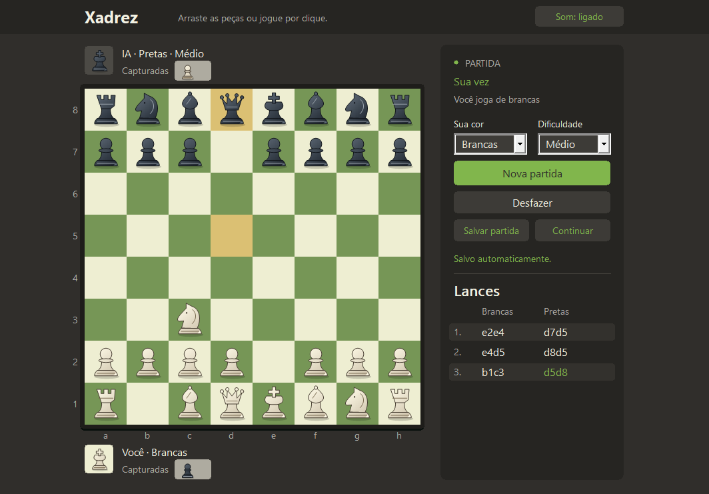

# Xadrez contra a IA

[Licença MIT](LICENSE) · C++17 · Windows · Versão 3.3


Jogo de xadrez offline em **C++17**, com interface nativa para Windows e motor de busca implementado no projeto. Escolha brancas ou pretas, jogue por clique ou arraste e retome a partida com salvamento automático.

Projeto de portfólio desenvolvido com apoio do **OpenAI Codex**, reunindo regras de xadrez, busca adversarial, programação de interface e testes de persistência. A IA usa minimax/negamax e heurísticas; não utiliza modelos de linguagem nem serviços externos.



Captura da interface executando uma posição de demonstração; peças, controles e mensagens são renderizados pelo próprio jogo.

## Recursos

- Três dificuldades; nível difícil com aprofundamento iterativo, poda alfa-beta e tabela de transposições.
- Tabuleiro clicável e arrastável, orientação automática e indicação de destinos legais.
- Roque, en passant, escolha de promoção, xeque-mate e empates.
- Peças capturadas, histórico e desfazer do turno completo, incluindo a resposta da IA.
- Salvamento automático, recuperação após fechar o processo e botão Continuar.
- Peças vetoriais, animações, logo própria e seis efeitos sonoros com opção de silenciar.
- Versão para terminal e testes automatizados de regras, IA e interface.

## Baixar e jogar no Windows, sem compilar

**[Baixar XadrezIA 3.3.0 para Windows x64](https://github.com/jvickz/xadrez-ia-cpp/releases/download/v3.3.0/XadrezIA-3.3.0-windows-x64.zip)** · [Página da versão e hashes SHA-256](https://github.com/jvickz/xadrez-ia-cpp/releases/tag/v3.3.0)

1. Baixe o ZIP acima e extraia todos os arquivos.
2. Abra **XadrezIA.exe** na pasta extraída.
3. Jogue; ao reabrir, clique em **Continuar** para retomar a partida salva.

O pacote inclui instruções e licenças. Não requer compilador, Python, Google Drive ou Windows Sandbox. O executável não tem assinatura digital; políticas do Windows podem avisar ou bloquear sua execução. Não recomendamos desativar proteções. Os arquivos **Source code** nas Releases são destinados a quem quer o código, e não contêm o jogo compilado.

## Compilar e instalar localmente no Windows

Primeiro compile o projeto conforme a seção **Compilar e testar**. O instalador espera `build/xadrez-grafico-v3.exe`, além dos arquivos de `assets/`. Clonar ou baixar apenas o código-fonte não fornece um executável pronto.

Execute `./instalar-local.ps1` na pasta do projeto para instalar a versão 3.3 em `%LOCALAPPDATA%\Programs\XadrezIA`. O script confere o SHA-256 da cópia e cria/atualiza os atalhos **Xadrez com IA - com sons** na área de trabalho e **Xadrez com IA** no menu Iniciar. Os atalhos usam o ícone próprio de cavalo em verde e marfim, disponível em `assets/xadrez.ico`.

A versão instalada abre pelo executável local `XadrezIA-v3.3.exe`, sem precisar do Google Drive ou da Área Restrita. Sons, desenhos das peças e logo estão incorporados ao executável. A instalação não altera políticas de segurança do Windows. O executável antigo pode continuar aberto até o usuário encerrar sua partida; os atalhos passam a abrir a atualização.

O desenho original do ícone está em `assets/logo.svg`. Para regenerar PNG e ICO em múltiplos tamanhos, execute `python assets/gerar-icone.py` com Pillow instalado. `app.rc` incorpora o ICO ao executável, e `app_icon.hpp` configura os ícones pequeno e grande da janela para a barra de título, Alt+Tab e barra de tarefas. Pillow é necessário apenas para regenerar a arte.

## Jogar com o tabuleiro no Windows

### Salvar e continuar depois

A partida é salva automaticamente a cada jogada sua e da IA, antes de terminar a animação. **Desfazer** também atualiza o arquivo. Você pode fechar sem clicar em salvar; ao reabrir pelo atalho, clique em **Continuar**. Abrir o jogo preserva o arquivo existente. Há um único espaço de salvamento: jogar uma nova partida substitui a anterior, e clicar em **Nova partida** já salva o novo início. O botão **Salvar partida** e **Ctrl+S** continuam disponíveis.

O painel mostra **Salvo automaticamente.** após gravar. Se houver falha, aparece um aviso em vermelho e o último arquivo salvo é preservado; uma nova tentativa ocorre na próxima jogada ou ao clicar em Salvar partida.

A posição, a vez de jogar, os lances, as capturas, a cor escolhida, a dificuldade e a opção de som são restaurados. O histórico de desfazer e as regras especiais também são reconstruídos. Se for a vez da IA, ela inicia um novo cálculo. É possível salvar durante uma animação ou enquanto a IA pensa: nesse caso, é guardado o último lance já aplicado ao tabuleiro.

O arquivo fica em `%LOCALAPPDATA%\XadrezIA\partida.sav`, separado da instalação e sem depender do Drive. A escrita usa um arquivo temporário e só substitui o salvamento anterior após concluir a gravação. Arquivos inválidos são recusados sem alterar a partida em andamento. Continuar com uma partida já em andamento pede confirmação antes de substituí-la.

A versão com sons, desfazer, animações e peças vetoriais está em `build/xadrez-grafico-v3.exe`.

O botão **Som: ligado / Som: desligado**, no topo da janela, ativa ou silencia os efeitos imediatamente. A escolha é mantida ao iniciar outra partida na mesma janela; ao abrir o programa, o som começa ligado. Há efeitos distintos para movimento, captura, xeque, vitória, derrota e empate. O som toca quando a peça chega à casa de destino, tanto nos seus lances como nos da IA. Fim de partida tem prioridade sobre xeque, que tem prioridade sobre captura e movimento. Desfazer e reiniciar cancelam sons pendentes.

Os efeitos são sintetizados pelo próprio programa, sem arquivos de áudio externos ou conexão à internet. A reprodução usa [PlaySound do Windows](https://learn.microsoft.com/en-us/previous-versions/dd743680(v=vs.85)) de forma assíncrona, mantendo a interface responsiva.

**Desfazer** volta à posição anterior ao seu último lance e também retira a resposta da IA. Funciona durante o cálculo da IA e depois do fim da partida, restaurando capturas, roque, en passant, promoções e contagem de repetições. Com as pretas, o primeiro lance das brancas é preservado. O atalho Ctrl+Z funciona com o foco no tabuleiro.

Os movimentos têm uma transição suave. A vitória mostra uma faixa animada com confetes e **Você venceu!**. A derrota mostra **Você perdeu**, com entrada animada e destaque vermelho. O painel lateral permite desfazer ou iniciar outra partida.

Abra `build/xadrez-grafico-v3.exe`. Para jogar, arraste uma peça sua até um dos destinos destacados ou clique na peça e depois no destino. Ao arrastar, a peça acompanha o cursor. Soltar em uma casa inválida ou fora do tabuleiro devolve a peça à origem. A tecla Esc cancela o arraste.

As duas casas do último lance ficam marcadas em amarelo. As faixas acima e abaixo do tabuleiro mostram as peças capturadas por cada jogador, incluindo capturas en passant. Uma nova partida limpa as duas listas.

Para fazer o roque, selecione ou arraste o rei duas casas para o lado da torre. A casa recebe a indicação **Roque** quando o lance é legal, e a torre se move automaticamente. O roque curto e o longo estão disponíveis para as duas cores. Rei e torre precisam conservar o direito ao roque, o caminho deve estar livre e o rei não pode estar em xeque, atravessar uma casa atacada ou terminar em xeque. [Regras e exemplos no Chess.com](https://www.chess.com/terms/castling-chess).

Quando um peão chega à última fileira, escolha a peça no menu de promoção.

O visual usa como referência a organização do [jogo contra o computador do Chess.com](https://www.chess.com/play/computer), com faixas de jogadores junto ao tabuleiro e controles no painel lateral.

Para trocar a cor ou a dificuldade, ajuste os seletores e clique em **Nova partida**. Ao escolher as pretas, o tabuleiro gira e a IA joga primeiro. Você também pode navegar no tabuleiro com as setas e usar Enter ou Espaço para selecionar uma peça ou jogar.

## Jogar no terminal

Abra `build/xadrez.exe` ou execute `.\build\xadrez.exe` no PowerShell, na pasta do projeto. Escolha a cor e o nível. As letras maiúsculas representam as peças brancas e as minúsculas, as pretas. O tabuleiro fica orientado para o seu lado.

| Entrada | Ação |
|---|---|
| `e2e4` | Move a peça de e2 para e4 |
| `e1g1` | Faz o roque curto das brancas, quando permitido |
| `e7e8q` | Promove o peão a dama. Use `r` para torre, `b` para bispo ou `n` para cavalo |
| `lances` | Lista os lances legais |
| `ajuda` | Mostra a legenda e os comandos |
| `sair` | Encerra a partida |

## Compilar e testar

No PowerShell, com GCC ou Clang para MinGW, ou Zig, execute na pasta do projeto:

```powershell
.\build.ps1 -Test
.\instalar-local.ps1
```

Compilador validado nesta revisão: **Zig 0.15.2, Windows x64**. É possível informar seu caminho com `-Compiler 'C:\caminho\zig.exe'`. Os demais compiladores são alternativas previstas pelo script, sem validação nesta máquina.

Se o Windows bloquear os executáveis de teste, compile-os sem executar e use o ambiente de testes já configurado, conforme [instruções da Área Restrita](sandbox/README.md):

```powershell
.\build.ps1 -BuildTests
.\sandbox\preparar-testes.ps1
```

`-BuildTests` compila o jogo e as duas suítes; `-Test` também as executa. O nome padrão da interface agora coincide com o esperado pelo instalador e pelo runner. A Área Restrita é uma alternativa de validação; não é uma dependência do jogo instalado.

Para gerar o pacote de distribuição após compilar e testar com a toolchain validada, execute `./empacotar-release.ps1`. Ele cria uma pasta nova em `dist/`, com ZIP e `SHA256SUMS.txt`, incluindo os avisos de runtime em `third-party/`. As notas da versão estão em [release/v3.3.0.md](release/v3.3.0.md).

Para incorporar a logo no Windows, o script usa `zig rc` com Zig, ou `windres` disponível no PATH com GCC/Clang. O nome de saída `xadrez-grafico-v3.exe` identifica a série 3; a instalação local atual corresponde à revisão 3.3.

O script gera os dois executáveis em `build/` e aceita `-Compiler` com o caminho do compilador. Em Linux ou macOS, compile a versão para terminal diretamente com um compilador C++17:

```sh
c++ -std=c++17 -O2 -Wall -Wextra -Wpedantic main.cpp chess.cpp ai.cpp -o xadrez
c++ -std=c++17 -O2 -Wall -Wextra -Wpedantic tests.cpp chess.cpp ai.cpp -o xadrez-tests
./xadrez-tests
./xadrez
```

No Windows, os testes da interface verificam a seleção e a prioridade dos efeitos, captura en passant, silêncio em lances inválidos, silenciar durante uma partida e cancelamento ao desfazer. Para testar também a reprodução real no dispositivo de áudio, execute `.\build\gui-tests.exe --audio-smoke`; esse comando toca os seis efeitos e verifica se o Windows aceitou a reprodução.

Os testes de persistência verificam salvamento automático humano e da IA, desfazer, resultado final, preservação ao abrir e falha de gravação com arquivo bloqueado. O runner da Área Restrita também executa `--write-autosave-test` e `--read-autosave-test` em processos separados: o primeiro faz um lance e encerra imediatamente, sem salvar manualmente ou executar o fechamento normal; o segundo confere a posição no disco.

## Motor e regras

`gui.cpp` desenha o tabuleiro com [Win32/GDI](https://learn.microsoft.com/en-us/windows/win32/gdi/wm-paint) e usa as mesmas regras e a mesma IA da versão para terminal. A busca roda em segundo plano para que a janela continue respondendo durante a vez da IA.

`chess.cpp` gera lances e descarta os que deixam o próprio rei em xeque. A posição guarda o lado a jogar, os direitos de roque, a casa de en passant e o contador de meios-lances.

`ai.cpp` usa minimax na forma negamax, com poda alfa-beta e prioridade para capturas e promoções. Os níveis fácil e médio buscam 1 e 2 meios-lances.

O nível difícil aprofunda a busca progressivamente até 8 meios-lances, com orçamento de aproximadamente 1,8 segundo por jogada. Uma tabela de transposições reaproveita posições calculadas na mesma busca. A análise de capturas, promoções e respostas a xeque continua nas folhas da busca para avaliar melhor as trocas de peças. A avaliação considera segurança do rei, estrutura de peões, peões passados, par de bispos e torres em colunas abertas, ajustando o papel do rei no final.

Ao atingir o tempo, o motor usa o resultado da última profundidade concluída. A profundidade alcançada depende da posição e do computador. O motor ainda avalia as posições sem consultar o histórico de repetições da partida.

O jogo reconhece xeque-mate, afogamento e os casos comuns de material insuficiente. Nesta versão casual, a terceira repetição de posição e a sequência de 50 lances de cada lado sem captura ou movimento de peão encerram a partida automaticamente. Em competição, esses dois casos dependem de solicitação segundo as [Leis do Xadrez da FIDE](https://handbook.fide.com/chapter/e012023).

Os testes incluem contagem de sequências de lances (*perft*) da posição inicial e da posição Kiwipete, regras especiais e uma posição em que a IA precisa encontrar mate em um lance. [Resultados de referência de perft](https://grandchesstree.com/perft-test).

O nível difícil também é testado com um mate forçado em três, para as duas cores, enumerando todas as defesas. Essa posição detecta uma falha da busca antiga de quatro meios-lances. Um teste de tempo verifica que a busca inicial retorna um lance legal em menos de cinco segundos, com margem para a variação de desempenho do computador.

## Organização do código

| Arquivo | Responsabilidade |
|---|---|
| `chess.hpp`, `chess.cpp` | Posições, lances legais, regras e resultados |
| `ai.cpp` | Busca e avaliação das posições |
| `match.hpp` | Histórico, capturas, repetições e desfazer |
| `gui.cpp` | Interface Win32/GDI+, eventos e busca em segundo plano |
| `savegame.hpp` | Validação dos arquivos e substituição atômica do salvamento |
| `pieces.hpp`, `sounds.hpp`, `app_icon.hpp` | Desenho das peças, áudio e ícone |
| `tests.cpp`, `gui_tests.cpp`, `savegame_tests.hpp` | Testes do motor, controlador e persistência |
| `main.cpp` | Interface para terminal |

## Limitações atuais

- A interface gráfica e a persistência usam APIs do Windows. A versão de terminal é separada e não tem os recursos de interface/salvamento da versão gráfica. Linux e macOS não foram validados nesta revisão.
- A IA não possui Elo medido, livro de aberturas, bases de finais ou integração UCI. A busca não considera o histórico de repetições, embora a partida reconheça o empate.
- Há um único arquivo salvo por usuário do Windows. Duas janelas compartilham esse arquivo; a última gravação bem-sucedida prevalece.
- A dificuldade e o som são salvos com a partida. Mudar apenas o som exige salvar manualmente ou fazer outro lance para persistir a preferência.
- O histórico usa coordenadas, sem importação/exportação PGN. Não há modo online, relógio ou autenticação.
- Os empates automáticos seguem a simplificação casual descrita acima; não se trata de uma implementação completa de arbitragem de torneios.
- O executável ainda não é assinado digitalmente. A abertura foi validada na máquina de desenvolvimento; isso não garante execução em outros PCs ou sob outras políticas de segurança. Não é necessário desativar proteções para consultar o código ou ver a demonstração.
- Escalas de tela diferentes, leitores de tela e várias versões do Windows ainda precisam de uma matriz de compatibilidade.

## Créditos e licença

O layout foi inspirado na organização de interfaces de xadrez como Chess.com. O projeto é independente, sem afiliação com essa plataforma. As peças e a logo são desenhadas no projeto; os sons são sintetizados em código.

Projeto de **João Vitor ([jvickz](https://github.com/jvickz))**, com desenvolvimento assistido por OpenAI Codex.

Distribuído sob a [licença MIT](LICENSE). Você pode usar, estudar, modificar e redistribuir o projeto, inclusive comercialmente, mantendo os avisos de autoria e licença. O software é fornecido sem garantia, conforme os termos da licença.
